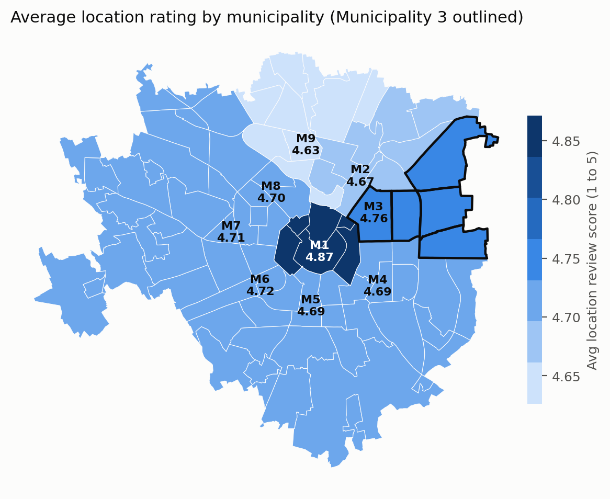
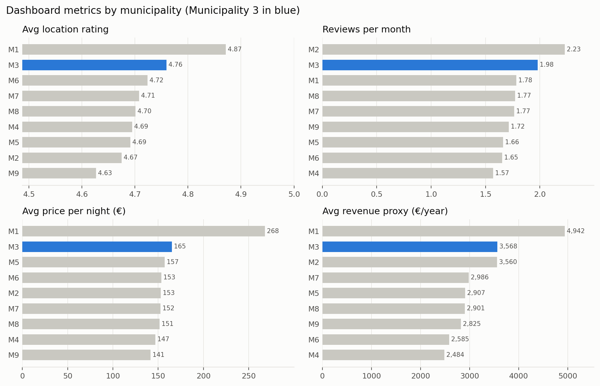
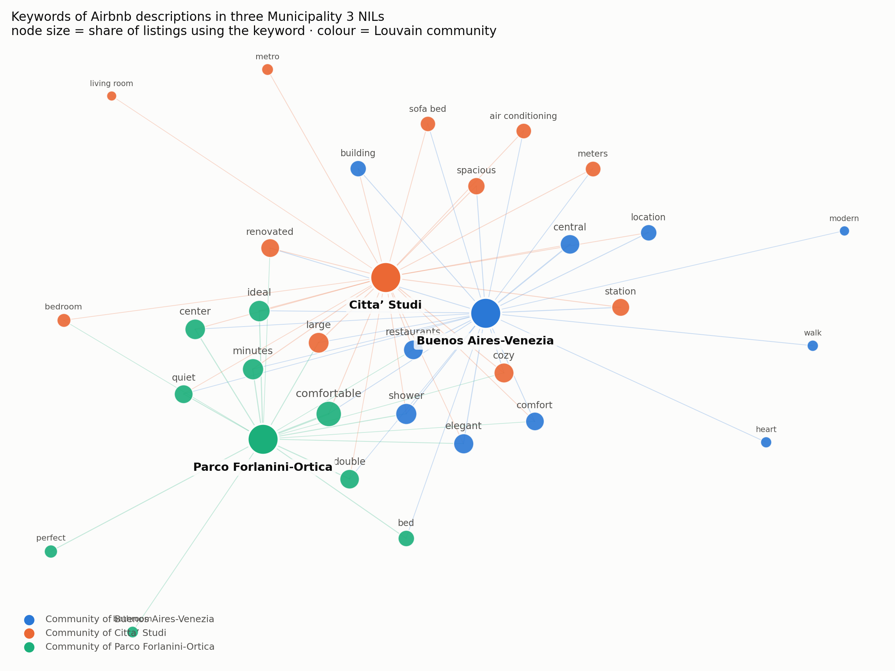

# Airbnb in Milan - Municipality 3

A visual analysis of the Airbnb market in Milan's Municipality 3 (Porta Venezia, Città Studi, Lambrate and the eastern neighbourhoods). We built it in **Tableau**, drew a keyword network in **Gephi**, and then rebuilt the whole analysis in Python.

[](https://public.tableau.com/views/Data_Viz_Project_2_17774885822280/Dashboard1)

**[Open the interactive dashboard on Tableau Public](https://public.tableau.com/views/Data_Viz_Project_2_17774885822280/Dashboard1)**

---
## Overview

For the Data Visualisation course, every group got one of Milan's nine municipalities and had to tell the story of its Airbnb market with interactive visual analytics. We wanted to answer three questions: how Municipality 3 compares to the rest of the city, which of its neighbourhoods (NILs) hold most of the listings and which listings actually perform well, and what hosts sell in terms of accessibility and of the words they use.

The Tableau workbook combines six sources: 20,139 Inside Airbnb listings (September 2025), the official NIL boundaries, the resident population from 2011 to 2023, house prices from Immobiliare.it, and driving times and road routes to the Duomo and to both airports. This repository explains that work and rewrites every calculated field and view in Python.

---
## Key findings

| Metric (dashboard switch)        | Municipality 3 | Rank out of 9 | First place             |
| -------------------------------- | -------------- | ------------- | ----------------------- |
| Average location review score    | 4.76           | 2nd           | Municipality 1 (4.87)   |
| Average reviews per month        | 1.98           | 2nd           | Municipality 2 (2.23)   |
| Average price per night (< €2,000) | €165         | 2nd           | Municipality 1 (€268)   |
| Average revenue proxy (€/year)   | €3,568         | 2nd           | Municipality 1 (€4,942) |

- **The closest alternative to the centre.** Municipality 3 comes second on every metric of the dashboard. Guests rate its locations almost as well as the historic centre, book it more often, and pay about 40% less per night.
- **Many listings in one place, but quality is spread out.** Buenos Aires-Venezia has 72% of the listings of the municipality and 25.9 listings every 1,000 residents, almost twice the city average. Still, Star Performer listings are one third of the total both there and in Città Studi: the neighbourhood has more listings, not better ones.
- **Prices follow house values.** The median price per night goes from €138 in Buenos Aires-Venezia to €104 in Città Studi and €91 in Parco Lambro-Cimiano, in the same order as the sale prices of houses (€7,902, €5,780 and €3,774 per m²).
- **Linate is the strong point of the east.** Every NIL is between 9 and 20 minutes by car from Linate, and all of them except Buenos Aires-Venezia are closer to Linate than to the Duomo.
- **Hosts describe where they are.** Listings in Buenos Aires-Venezia talk about central, heart, restaurants, elegant, those in Città Studi about large, spacious, renovated, metro, and those in Parco Forlanini-Ortica about comfortable, quiet, minutes.

You can find the full discussion in the [report](reports/report.pdf).

<p align="center">
  
  
</p>

---
## Repository structure

```
dv-airbnb-milan/
├── tableau/
│   └── Data_Viz_Project_2.twbx       packaged Tableau workbook (data extracts included)
├── data/
│   ├── raw/                          Inside Airbnb listings, NIL boundaries, context tables
│   └── processed/                    tables created by the scripts
├── reports/
│   ├── figures/                      figures created by the scripts
│   └── report.pdf                    full report
├── scripts/
│   ├── prepare_data.py               data cleaning and Tableau calculated fields in pandas
│   ├── make_figures.py               static versions of the Tableau views
│   ├── build_text_network.py         rebuilt Gephi keyword network
│   └── extract_tableau_data.py       recreates the context tables from the .twbx (optional)
├── requirements.txt
├── LICENSE
└── README.md
```

---
## Exploring the Tableau workbook

The interactive dashboard is online on [Tableau Public](https://public.tableau.com/views/Data_Viz_Project_2_17774885822280/Dashboard1). To open the workbook on your computer, install the free [Tableau Public](https://www.tableau.com/products/public/download) app and open `tableau/Data_Viz_Project_2.twbx`. The data is packaged inside the file, so no other file is needed.

The workbook contains:

| Sheet / dashboard            | What it shows |
| ---------------------------- | ------------- |
| **Dashboard 1**              | *Territorial Context and Analysis*: a map and a ranking controlled by the *Select Metric* and *Drill Municipality* parameters |
| Map, Top NILs by Metric      | the two views of the dashboard |
| Map (2)                      | sale price of houses per m² by NIL |
| Matrix + Dots                | every listing of Municipality 3 placed by NIL and Performance Tier, sized by Performance Index |
| Boxplot                      | distribution of the price per night by NIL |
| Connection Map (2)           | road routes from a chosen NIL to the Duomo, Linate and Malpensa |

---
## Reproducing the analysis

The scripts only use the files saved in `data/raw/` and always give the same result (the network layout and the community detection use a fixed seed).

```bash
# 1. clone
git clone https://github.com/simonecobuccio/dv-airbnb-milan.git
cd dv-airbnb-milan

# 2. install (Python 3.10+ recommended)
python -m venv .venv
source .venv/bin/activate           # on Windows: .venv\Scripts\activate
pip install -r requirements.txt

# 3. run
python scripts/prepare_data.py        # data/processed/*.csv
python scripts/make_figures.py        # reports/figures/fig01 to fig07
python scripts/build_text_network.py  # reports/figures/fig08 and the network tables
```

---
## Data

- **Listings**: [Inside Airbnb](https://insideairbnb.com/get-the-data/), Milan, collected on 22 to 24 September 2025 (20,139 listings, 62 columns). The version used in the course adds two columns of keywords (`tags`, `tags 2`) extracted from the descriptions. Prices are in euro, even if the column says dollars.
- **NIL boundaries** and **population by NIL from 2011 to 2023** (`ds205`): [Comune di Milano open data](https://dati.comune.milano.it/).
- **House prices by NIL**: sale and rent prices per m² from Immobiliare.it, collected during the course.
- **Driving times and routes**: car routes from each NIL to the Duomo, Linate and Malpensa, collected during the course.

Inside Airbnb and Comune di Milano data are released under CC BY 4.0 licences, and the credit goes to the original publishers.

---
## Methodology

`prepare_data.py` fixes a broken NIL name, assigns the 88 NILs to the nine municipalities and rewrites the calculated fields of the workbook. These are the metric switch of the dashboard (location score, reviews per month, price and a revenue proxy, leaving out listings at €2,000 or more per night), the **Performance Index** (rating × reviews in the last 12 months / price) with its three tiers, and the price tiers. Population is linked to the listings through the official NIL code. The original Gephi project was not saved, so `build_text_network.py` rebuilds the keyword network from the `tags` column: it fixes a problem in the extracted keywords, keeps the keywords used by at least 8% of the listings of each NIL, and finds the communities with Louvain (the same method behind the *Modularity Class* in Gephi). The limits of the proxies and of using a single snapshot are discussed in the [report](reports/report.pdf).

---
## Documentation

- [**Full report (PDF)**](reports/report.pdf): data, calculated fields, results, design choices and limits

---

## Authors

Group project for the Data Visualisation course of the **Master in Business Analytics and Data Science** at **Politecnico di Milano** GSoM 2025/2026.

- Nur Alam
- Alexandre Benjamin Cambier
- Simone Cobuccio
- Giancarlo Ferrara
- Davide Tissino

---

## License

The code is released under the [MIT License](LICENSE). The data stays under the licences of the original publishers.
